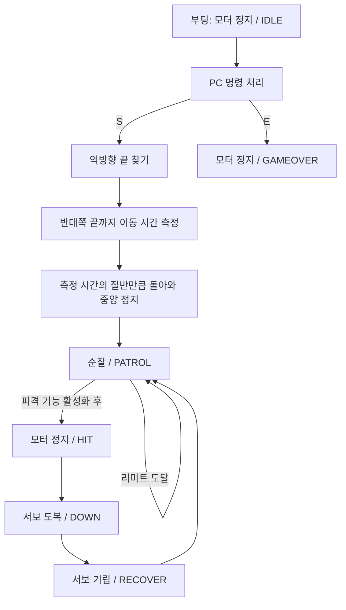

# 팀 통합 코드 실행 안내

대상 보드: **NUCLEO-F411RE (STM32F411RE)** · 개발 도구: **IAR EWARM** · 라이브러리: **STM32F4 Standard Peripheral Library(SPL) V1.9.0**.

개인 작업 원본은 `individual/`에 그대로 보관했습니다. 통합 펌웨어는 이 폴더의 `Integration.eww`로 엽니다. 아래 준비를 마쳐야 빌드할 수 있습니다. 저장소에는 IAR와 ST 라이브러리가 포함되어 있지 않습니다.

## 1. 현재 가능한 동작부터 확인

| 기능 | 현재 상태 |
| --- | --- |
| CdS 9채널 측정 → PC 전송 | 연결됨. 10ms 주기로 측정하고 통신 프레임에 반영 |
| PC `S` 명령 → 모터 원점 찾기 → 중앙 정렬 → 순찰 | 연결됨 |
| PC `E` 명령 → 모터 정지 | 원점 찾기·순찰·피격 처리 중 모두 처리 가능 |
| PC `1`~`5` 명령 → 순찰 속도 변경 | 듀티 30 / 40 / 50 / 60 / 70%. 호밍은 기존 80% 유지 |
| 센서 피격 판정 | **기본 비활성**. 실제 조명 아래 센서 기준값을 정한 뒤 활성화 |
| 서보 PWM | 최신 개인 구현의 **PB9 / TIM4_CH4** 연결. 부팅 시 기존 90° 출력, 기립·도복 각도 확인 필요 |
| 제한시간 종료 | 팀의 시간이 정해지지 않아 기본 비활성. PC `E`로 종료 |

따라서 현재 버전은 **모터 + 센서 + PC 통신 통합 실행용**입니다. 서보를 포함한 전체 게임을 완료하려면 7절의 기립·도복 각도와 센서 기준값을 보정해야 합니다. 최신 서보 개인 코드의 PB9 배선을 그대로 유지했습니다.

## 2. 폴더와 실행 흐름

```text
integration/
├── Integration.eww          ← IAR에서 여는 파일
├── Integration.ewp          ← F411RE Debug 빌드 설정
├── Libraries/               ← 수업용 SPL V1.9.0을 직접 복사 (미포함)
├── firmware/
│   ├── main.c               ← 초기화, 명령 수신, 제어·센서·통신 반복 실행
│   ├── config.h             ← 시간·속도·피격 기준 등 조정값
│   ├── game.c / game.h      ← 게임 상태와 각 모듈의 실행 순서
│   ├── motor.c / motor.h    ← 원점 찾기, 중앙 정렬, 순찰, 정지, 오류
│   ├── sensors.c / sensors.h← 기존 순서대로 ADC 9채널 읽기
│   ├── servo.c / servo.h    ← 기존 PB9 / TIM4_CH4 서보 PWM
│   ├── comm.c / comm.h      ← USART2 송수신 및 상태 전송
│   ├── protocol.c / .h      ← 기존 27바이트 패킷 및 CRC
│   ├── timebase.c / .h      ← TIM2 1ms 시간 관리
│   ├── stm32f4xx_conf.h     ← 사용하는 SPL 헤더
│   ├── system_stm32f4xx.c   ← 기존 HSI 16MHz 시스템 설정
│   ├── startup_stm32f411xe.s← F411 시작 코드
│   └── ST_CMSIS_LICENSE.md  ← 복사한 ST 지원 파일의 라이선스
└── tests/                   ← PC에서 제어 흐름을 확인하는 검사
```



`S`로 시작한 호밍 중에도 메인 반복문이 계속 실행되므로 통신이 멈추지 않습니다. `E`는 어느 동작에서든 처리합니다. 기존 통신 규격에는 HOMING 상태가 없어 원점 찾기 중 PC에는 IDLE로 표시하고, 중앙 정렬 후 PATROL로 바뀝니다. 게임 진행 중 중복 `S`는 무시합니다.

## 3. 기존 배선표 — 핀 변경 없음

### 모터·스위치·통신

| 장치 | 기존 핀 | 사용 자원 / 조건 |
| --- | --- | --- |
| 모터 A-IA | PA8 | TIM1_CH1, 20kHz PWM |
| 모터 A-IB | PA9 | TIM1_CH2, 20kHz PWM |
| 역방향 끝 스위치 | PB4 | 내부 풀업, 눌림 = LOW |
| 정방향 끝 스위치 | PB10 | 내부 풀업, 눌림 = LOW |
| PC 송신 | PA2 | USART2 TX, ST-LINK 가상 COM |
| PC 수신 | PA3 | USART2 RX, ST-LINK 가상 COM |
| 보드 LED | PA5 | 클럭 설정 오류 표시 |
| 서보 SG90 | PB9 | TIM4_CH4, 주기 20ms, 기존 90° 펄스 1.5ms |

스위치 핀은 그대로이며, 감지 방식은 EXTI 인터럽트에서 메인 반복문의 입력 확인(polling)으로 통합했습니다. 방향별 도착 스위치를 구분하고, 출발 스위치가 300ms 후에도 눌려 있거나 주행이 4500ms를 넘으면 정지합니다. 스위치 두 개가 동시에 눌려도 정지합니다. 원본의 스위치 LED 토글·오류 횟수 깜빡임은 이 버전에 포함하지 않았으며, 오류는 IAR에서 `Motor_Error()`와 `Motor_Status()`로 확인합니다.

### CdS — 채널 순서 유지

| 센서 / PC 표시 순서 | 핀 | ADC 채널 | 보드 연결 위치 |
| --- | --- | --- | --- |
| 1 | PA0 | 0 | A0 |
| 2 | PA1 | 1 | A1 |
| 3 | PA4 | 4 | A2 |
| 4 | PB0 | 8 | A3 |
| 5 | PC1 | 11 | A4, 기본 보드 라우팅 |
| 6 | PC0 | 10 | A5, 기본 보드 라우팅 |
| 7 | PB1 | 9 | CN10 24번 |
| 8 | PC2 | 12 | CN7 35번 |
| 9 | PC3 | 13 | CN7 37번 |

기존 센서 회로: `3.3V — 10kΩ 저항 — ADC 핀 — CdS — GND`. 센서 순서와 물리적인 표적 위치의 대응은 설치한 순서대로 확인합니다.

## 4. IAR에서 빌드하고 보드에 기록

1. 저장소를 내려받거나 최신 상태로 갱신합니다. 그다음 `integration/`을 엽니다.
2. 수업에서 쓰던 **STM32F4 SPL V1.9.0의 `Libraries` 폴더 전체**를 `integration/` 바로 아래에 복사합니다. 아래 경로가 실제 존재해야 합니다.

   ```text
   integration/Libraries/CMSIS/Include/core_cm4.h
   integration/Libraries/CMSIS/Device/ST/STM32F4xx/Include/stm32f4xx.h
   integration/Libraries/STM32F4xx_StdPeriph_Driver/inc/stm32f4xx_gpio.h
   integration/Libraries/STM32F4xx_StdPeriph_Driver/src/stm32f4xx_tim.c
   ```

3. IAR EWARM에서 **`integration/Integration.eww`**를 엽니다. 구성은 **Debug**를 사용합니다. 프로젝트는 기존 ADC 프로젝트 설정을 바탕으로 만들었습니다.
4. `Project → Options`에서 다음을 확인합니다.

   | 항목 | 값 |
   | --- | --- |
   | General Options → Target | ST STM32F411RE |
   | C/C++ Compiler → Preprocessor → Defined symbols | `USE_STDPERIPH_DRIVER`, `STM32F411xE` |
   | Include directories | 프로젝트에 등록된 `firmware` 및 위 Libraries의 세 Include/inc 경로 |
   | Linker → Config | IAR의 `config/linker/ST/stm32f411xE.icf` |
   | Debugger → Driver | ST-LINK (설치한 IAR에서 확인/선택) |

5. `Project → Rebuild All`로 빌드합니다. 라이브러리 경로 오류가 나면 2번의 폴더 깊이를 먼저 확인합니다.
6. NUCLEO 보드의 **ST-LINK USB 포트**를 PC에 연결합니다. 모터 드라이버·서보 전원은 기존 하드웨어 구성을 사용합니다.
7. `Project → Download and Debug`로 기록하고 `Go`로 실행합니다. 처음에는 모터가 정지하고 PC 명령을 기다립니다.

**개인 프로젝트의 `main.c`, `main_comm_test.c`, `stm32f4xx_it.c`, TIM2/USART2 핸들러를 추가로 넣지 않습니다.** 통합 프로젝트에는 `main` 하나, TIM2 인터럽트 하나, USART2 인터럽트 하나만 등록되어 있습니다. 기존 `Libraries`는 이 저장소에서 추적하지 않습니다.

클럭은 기존 모터·통신 코드와 같은 **HSI 16MHz / APB1·APB2 분주 1**입니다. 시스템 파일의 `SetSysClock()` 호출을 켜지 마세요. 설정이 다르면 부팅 시 모터를 정지한 채 PA5 LED를 켜고 멈춥니다.

## 5. PC에서 실제 실행

### MATLAB 대시보드 사용

1. MATLAB에서 저장소의 `individual/juwon/laser_comm_usart/pc_matlab/` 폴더로 이동합니다.
2. 명령 창에서 실행합니다.

   ```matlab
   LaserDashboard
   ```

3. 데모 포트 대신 보드의 실제 포트를 선택하고 **Connect**합니다. Windows는 `COM…`, macOS는 `/dev/cu.usbmodem…` 형태입니다. 다른 시리얼 프로그램이 포트를 사용 중이면 닫습니다.
4. 시작 전 ADC 9채널 값이 수신되는지 확인합니다.
5. 게임 시작을 누르면 `S`가 전송됩니다. 모터가 **역방향 끝 → 정방향 끝 → 중앙** 순서로 이동한 뒤 순찰합니다. 처음에는 이동 경로와 두 리미트 스위치의 작동을 확인합니다.
6. 종료를 누르면 `E`가 전송되고 모터가 멈춥니다. 속도 1~5는 순찰 듀티를 바꿉니다.

통신 규격은 기존과 동일한 **115200 bps, 8-N-1**, 27바이트 상태 프레임입니다. Python 수신 검사와 추가 안내는 [주원 통신 테스트 가이드](../individual/juwon/laser_comm_usart/TEST_GUIDE.md)를 참고합니다. 가짜 ADC를 보내는 통신 단독 펌웨어 대신 **통합 펌웨어**를 보드에 기록해야 합니다.

### MATLAB 없이 Python으로 시작·종료

Python 3와 `pyserial`이 필요합니다. 터미널에서 설치하고 실제 포트를 확인합니다.

```bash
python3 -m pip install pyserial
python3 -m serial.tools.list_ports
```

아래 코드의 `PORT`를 목록에서 확인한 포트로 바꿔 Python에서 실행합니다. 실행 후 Enter를 눌러 종료 명령을 보냅니다. MATLAB 등 다른 프로그램의 포트 연결은 먼저 끊습니다.

```python
import serial

PORT = "COM3"  # macOS 예: /dev/cu.usbmodem1103
with serial.Serial(PORT, 115200, timeout=1) as board:
    board.write(b"S")
    try:
        input("원점 찾기 후 순찰 중입니다. Enter를 누르면 정지합니다. ")
    finally:
        board.write(b"E")
        board.flush()
```

## 6. 문제가 생겼을 때

| 증상 | 확인할 내용 |
| --- | --- |
| 헤더/소스 파일을 찾을 수 없음 | SPL `Libraries` 위치와 버전 확인 |
| main 또는 IRQ 중복 정의 | 개인 테스트 소스를 통합 프로젝트에 추가했는지 확인 |
| ST-LINK 연결 실패 | USB 포트, 데이터 케이블, ST-LINK 드라이버, IAR Debugger 설정 확인 |
| COM 포트가 안 보임 | ST-LINK USB 연결과 가상 COM 드라이버 확인 |
| 부팅 후 LED가 켜지고 아무 동작 없음 | 클럭 검사에서 중단됐는지 `main.c` 확인 |
| ADC 오류로 GAMEOVER | 센서 변환 시간초과. IAR에서 `adc_error` 확인 |
| 원점 찾기 중 GAMEOVER | 아래 `Motor_Error()` 코드와 스위치 방향/접점 확인 |
| 값은 수신되지만 피격/서보 반응 없음 | 피격은 기본 비활성. 서보는 부팅 시 90° 기준 출력. 7절 보정 필요 |

`Motor_Error()` 오류 코드:

| 값 | 뜻 |
| --- | --- |
| 0 | 모터 오류 없음 |
| 1 | 역방향 끝 찾기 4500ms 초과 |
| 2 | 정방향 끝 찾기 4500ms 초과 |
| 3 | 측정한 편도 시간이 기존 범위 1500~4000ms 밖 |
| 4 | 중앙 복귀 중 예상 밖 스위치 입력 |
| 5 | 두 스위치가 동시에 눌림 |
| 6 | 출발 스위치가 300ms 이후에도 눌려 있음 |
| 7 | 순찰 중 다음 끝에 4500ms 안에 도착하지 못함 |
| 8 | 내부 모터 단계 오류 |

오류 시 모터는 정지합니다. 원인을 확인한 뒤 `S`를 다시 보내면 호밍부터 재시도합니다. `E`는 정지 상태로 만듭니다. 느린 속도에서 실제 편도 시간이 4500ms보다 길면 타임아웃이 발생할 수 있으므로 측정 후 `config.h`의 시간을 조정합니다.

## 7. 전체 게임을 완성할 때 필요한 두 작업

### 기립·도복 각도 확인

최신 준엽 개인 코드의 SG90 드라이버를 통합했습니다. **PB9 / TIM4_CH4**를 그대로 사용하고, 기존과 같이 부팅 시 90°(1.5ms 펄스)를 출력합니다. 모터 TIM1, 시간 관리 TIM2와 충돌하지 않습니다. 서보 전원과 공통 GND도 기존 배선을 유지합니다.

원본은 90° 테스트까지만 있어 실제 표적의 기립·도복 각도는 알 수 없습니다. `config.h`의 `SERVO_STAND_ANGLE`, `SERVO_DOWN_ANGLE`을 장착 상태에 맞게 설정하고 `SERVO_POSES_CONFIRMED`를 `1`로 바꿉니다. 기본값은 둘 다 원본의 90°이며, 임의로 다른 각도로 꺾지 않습니다. `Servo_SetAngle()`은 원본과 같은 0~180° / 1~2ms 범위로 제한합니다.

서보 함수는 PWM만 변경하며 이동 대기는 게임 제어부가 담당합니다. 추가 타이머나 SysTick 지연 코드를 가져오지 않았습니다.

### 피격 기준 보정

1. PC에 표시되는 각 센서의 평상시 값과 레이저를 비췄을 때 값을 기록합니다.
2. `config.h`에서 `HIT_ACTIVE_HIGH`를 정합니다. 빛을 비췄을 때 값이 커지면 `1`, 작아지면 `0`입니다.
3. `HIT_THRESHOLD`는 피격 기준, `HIT_RELEASE_THRESHOLD`는 재무장 기준으로 정합니다. 값이 커지는 회로는 재무장 기준을 피격 기준보다 낮게, 작아지는 회로는 높게 둡니다. 현재 3000/2500은 **실측하지 않은 예시값**입니다.
4. `HIT_DETECTION_ENABLED`를 `1`로 바꾸고 다시 빌드·기록합니다. `SERVO_POSES_CONFIRMED`도 `1`이어야 피격 처리가 활성화됩니다.
5. 한 번 비춘 빛으로 피격이 반복 집계되지 않는지 확인합니다. 센서가 재무장 기준으로 돌아온 뒤에만 다음 피격을 받습니다.

기본 제어 시간은 피격 후 100ms → 도복 1500ms → 기립 대기 300ms입니다. 실제 서보에 맞춰 조정합니다. 반응 시간은 순찰 상태가 된 뒤 피격까지의 ms이며 65535ms로 상한 처리합니다. 피격 횟수는 기존 통신대로 부팅 이후 누적되는 8비트 값(255 다음 0)입니다. 자동 게임 종료를 쓰려면 `GAME_DURATION_MS`를 설정합니다. 제한시간은 호밍 완료 후부터 계산합니다.

## 8. PC에서 제어 흐름 검사

저장소 루트에서 Python 3와 C 컴파일러(`cc`, macOS는 Xcode Command Line Tools)가 있는 환경에서 실행합니다.

```bash
python3 integration/tests/run_checks.py
```

실제 `motor.c`, `game.c`, `protocol.c`를 사용하고 GPIO/PWM 하드웨어 호출만 가짜 값으로 바꿔 검사합니다. 시작·중단·호밍·중앙 정렬·속도 변경·방향 반전·타임아웃·스위치 오류·오류 후 재시작·시간 카운터 순환과 피격 기능 켜짐/꺼짐을 확인합니다. 패킷 CRC와 IAR 소스 경로·인터럽트 중복 여부도 검사합니다.

**검증 범위:** 이 검사는 실물 보드 동작이나 IAR/SPL 전체 빌드를 보증하지 않습니다. 작성 환경에 IAR 및 SPL이 없어 펌웨어 전체 빌드와 실제 하드웨어 검증은 아직 수행하지 않았습니다. 팀원이 4~5절대로 빌드·기록한 뒤 실제 배선에서 확인해야 합니다.
